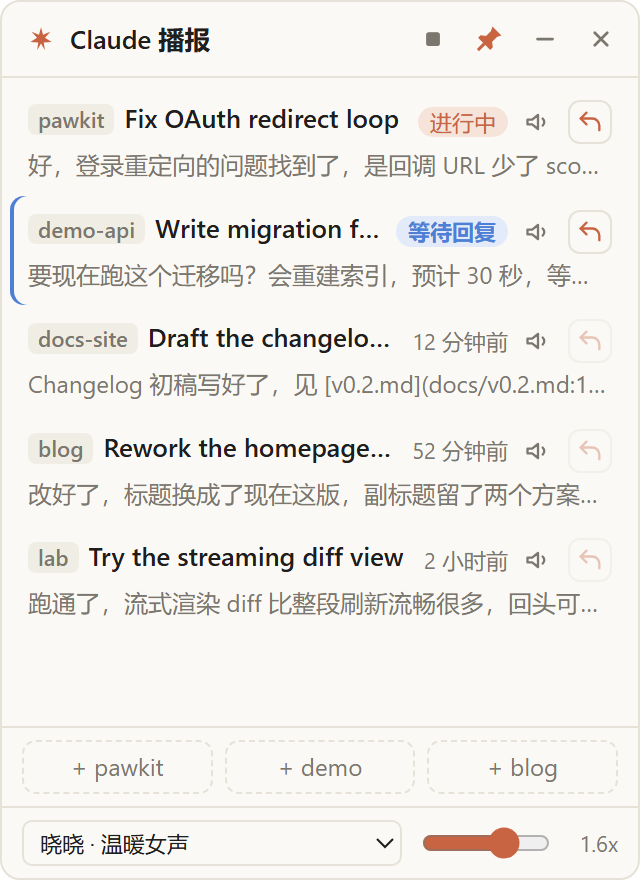

# claude-float

[English](README.md) · [简体中文](README.zh-CN.md)

  

An always-on-top floating widget for **Claude Code** and **Codex** (the CLIs) on Windows. See all your sessions at a glance, have the latest reply read aloud, and answer without ever leaving your current window.

<p align="center"></p>

## Why

Claude Code runs in a terminal, which means switching windows just to check whether Claude finished, what it said, or to type back one sentence. This widget stays pinned in a corner and does the three things you actually do all the time:

1. **Glance** — is Claude working, waiting for my answer, or done?
2. **Listen** — read the latest reply aloud while you keep typing in your editor
3. **Reply** — send one-liners straight into the session, no window switch

## Features

- **Claude / Codex, one click apart** — the header toggle switches the whole widget between the two: session list, theme color, quick-launch command and reply plumbing
- **Session list** — reads `~/.claude/projects/*/*.jsonl` (read-only), shows your recent sessions
- **Live status** per session: **Working** / **Waiting for you** (Claude asked a question, plan approval, long-running tool call) / how long ago the last reply came. Prefers the status Claude Code itself writes to `~/.claude/sessions/<pid>.json`; falls back to guessing from the transcript when the session isn't running
- **Subscription usage** (optional) — one line at the bottom showing the GLM Coding Plan quota per reset window (`5-hour 64% · weekly 38%`); hover for remaining credits and reset times, click to open the console. Only shows up when you put an API key in `~/.claude-float/glm.json`
- **Click a row**:
  - session still running → toggle its terminal between foreground/background (click again while in front to minimize)
  - session already exited → opens a fresh PowerShell terminal in the session's original directory and runs `claude --resume <id>`
- **Read aloud** (speaker icon) — speaks the latest reply; click again, click the stop button, or press `Esc` to stop. Markdown is cleaned up before speaking: code blocks become "code omitted", links speak their text only, paths speak just the filename, tables are read row by row
- **Quick reply** (orange arrow, sessions started with `cf`) — type in the widget, `Enter` to send / `Shift+Enter` newline / `Esc` cancel. Messages go into the session through Claude Code's official [Channels](https://code.claude.com/docs/en/channels) (research preview) — no window switching, no keystroke simulation into your terminal. Idle Claude replies immediately; a busy Claude gets it on the next turn
- **Quick launch** — clicking a bottom button pops a menu: start a plain session in that directory, create a todo ticket for it, or start a session bound to one of its open tickets (new PowerShell window; the window stays at the prompt after Claude exits so you can scroll back)
- **Todo tickets** (clipboard icon in the header, with an open-count badge) — a lightweight kanban of things you want done, one list per quick-launch directory ("workspace"). Create with title + optional description + workspace; filter by workspace, default to open ones, switch to see done. Start a session from a ticket (or pick a ticket in the launch menu) and the new session is **auto-bound** to it: the widget notices the new session in that directory and records its id (`~/.claude-float/todos.json`). Bound sessions get a ticket tag on the session row — click it to jump to the ticket; the ticket shows the live working/waiting status of its sessions. Manual bind/unbind from the ticket's expanded row
- **Desktop pet** — a little companion squatting in a screen corner that mirrors your sessions: runs in place while a session works, tilts its head when one waits for you, jumps to celebrate a finished task, and wears a count badge when sessions await your input. **A session tray sits above the pet** (working / waiting / just-finished sessions; none → just the pet): waiting-first ordering, colored status dots; finished sessions linger as "idle" until you've looked at them, click a row to jump to that terminal (opening a waiting/idle row marks it handled and it leaves the tray). Click the pet to toggle the widget, double-click to hide (tray menu brings it back). Reads Codex pet packs from `~/.codex/pets/` out of the box; your own pets go into `~/.claude-float/pets/`. Toggle and pick pets from the tray menu
- **Widget niceties** — pin / collapse to a 40px bar / hide to tray; position, size and pinned state are remembered. Tray icon toggles visibility; tray menu has optional "run at login" (off by default)
- **Text-to-speech**: online neural voices by default (same voices as Edge "Read Aloud" — natural-sounding), or offline system voices as fallback

### Codex mode

The same widget, pointed at Codex CLI sessions (`~/.codex/sessions/**/rollout-*.jsonl`, read-only; honors `CODEX_HOME`):

- **Session list + status** — Codex has no live-session registry, so status (working / waiting for approval / idle) is inferred from the transcript tail, same heuristics spirit as the Claude fallback
- **Titles** — prefers the official thread names the desktop app writes to `~/.codex/session_index.jsonl`; pure-CLI sessions fall back to the first prompt
- **Click a row** — live session → focus/minimize its terminal; exited session → fresh PowerShell in the original directory running `codex resume <id>`
- **Quick reply** — Codex has no channels equivalent; while the session is still running in a terminal, the widget types straight into its console via `WriteConsoleInputW` (no focus steal, no clipboard). A session is matched to its process by comparing the rollout's session-creation timestamp with `codex` process start times (the process must predate the session by ≤15 min — the first launch in a new directory waits on a trust prompt, which delays session creation by minutes); sessions started from the Codex Desktop app have no console and can't be quick-replied — resume them instead
- **Quick launch** — the bottom buttons start `codex` in your quick-launch directories

## Quick start

**Prerequisites**: Windows 10/11, Node.js 20+, [Claude Code CLI](https://docs.claude.com/en/docs/claude-code/overview) installed and working in a terminal. Codex support needs the [Codex CLI](https://developers.openai.com/codex/) on `PATH` (optional).

```bash
git clone https://github.com/kizenY/claude-float.git
cd claude-float
npm install
claude mcp add -s user claude-float -- node <path-to-repo>/channel/server.js   # enables quick reply
npm start
```

For daily use, launch `start.vbs` (no console window flashes). To start it at login, use the tray menu → 「开机自动运行」(writes to `HKCU\...\CurrentVersion\Run`, uncheck to remove). To make the app findable via Win-key search: `powershell -File scripts\start-menu.ps1` (adds a `claude-float` Start Menu shortcut; `-Remove` undoes).

> The `claude mcp add` line registers the channel server at user scope, so every Claude session can load it. Only sessions started via `cf` (below) actually enable the channel — the widget only shows the reply button for those. To unregister: `claude mcp remove claude-float`.

### The `cf` launcher

`cf.cmd` in the repo starts Claude Code with the channel enabled:

```
cf [any normal claude arguments]
```

The first launch shows a one-time development-channels warning — pick "I am using this for local development". Sessions not started with `cf` show a dimmed reply button; there's no way to attach a channel to an already-running session.

`cf` also supports an optional routing gateway (see "Routing gateway" above) — without a gateway.conf it's just a plain `claude` launcher.

## Configuration

### Quick-launch directories

`~/.claude-float/quick-dirs.json`:

```json
[
  { "name": "proj-a", "path": "D:\\work\\proj-a" },
  { "name": "lab", "path": "D:\\lab" }
]
```

Without this file you get a single `home` button. Restart the widget after editing. These directories double as the workspaces of todo tickets.

### Desktop pet

The pet window scans two directories; your own win when ids collide:

| Directory | Purpose |
|---|---|
| `~/.claude-float/pets/<id>/` | your own pets |
| `~/.codex/pets/<id>/` | [Codex CLI](https://developers.openai.com/codex/) pets, imported automatically — nothing to do |

One directory per pet, containing `pet.json` plus a spritesheet (PNG / WebP) — same format as CodeX:

```json
{
  "displayName": "Pingan",
  "description": "A plush puppy",
  "spritesheetPath": "spritesheet.png",
  "frame": { "width": 192, "height": 208, "columns": 8, "rows": 9 },
  "animations": { "wave": { "frames": [24, 25, 26, 27], "fps": 7, "loop": false } }
}
```

- The spritesheet is cut on a grid: each frame is `width x height` pixels, `columns x rows` cells must tile the image exactly. `frame` is optional — defaults to 192x208 frames, 8 columns, with rows derived from the image height
- Frame indices count left-to-right, top-to-bottom. Built-in animation rows: 0 idle · 1 run right · 2 run left · 3 wave · 4 jump · 5 sad · 6 waiting · 7 run in place · 8 review. `animations` is optional and overrides/adds tracks (fps defaults to 8; `loop: false` plays once, then falls back to idle)
- The session tray sits permanently above the pet: waiting-first ordering, colored status dots; just-finished sessions linger as "idle · N min ago" until opened, working sessions always shown; opening a waiting/idle row marks it handled and it leaves the tray (it returns automatically when active again). Sessions waiting on you also show a count badge on the pet. Position, on/off switch and the selected pet are all in the tray menu; drag the pet anywhere, single-click toggles the widget, double-click to hide

### Routing gateway (optional)

The widget plays nice with a local gateway that routes requests to high/low-tier models by complexity. All gateway wiring stays on your machine — the repo contains no personal paths.

`~/.claude-float/gateway.conf` (two lines, ASCII):

```
health=http://127.0.0.1:8787/health
settings=C:\path\to\gateway-settings.json
```

- With this file, `cf` probes `health` before launching; if it answers, the JSON profile at `settings` is attached to the new session via `--settings` (use `ANTHROPIC_AUTH_TOKEN` in the profile — `ANTHROPIC_API_KEY` triggers Claude Code's "custom API key" approval prompt on every session)
- No file = plain direct sessions, zero gateway logic in `cf`
- The tray menu's **"route new sessions through the gateway"** switch (only appears when gateway.conf exists) toggles this by creating/deleting `~/.claude-float/gateway-off`; it only affects sessions started afterwards

### Subscription usage (GLM Coding Plan)

`~/.claude-float/glm.json`:

```json
{ "apiKey": "your Coding Plan API key" }
```

One line at the widget's bottom shows `5-hour 64% · 18:24 reset · weekly 38% · 10/21 reset` (used percentage and reset time per window; the main process polls the [official usage endpoint](https://docs.bigmodel.cn/cn/coding-plan/overview) once a minute). On Z.ai add `"endpoint": "https://api.z.ai"`. No file → the line stays hidden, nothing else changes.

### Environment variables

| Variable | Purpose |
|---|---|
| `CLAUDE_FLOAT_PROJECTS` | Comma-separated keywords; only show sessions whose project directory name matches, e.g. `pawkit,lab` |
| `CLAUDE_FLOAT_CODEX_EXCLUDE` | Codex mode: comma-separated keywords; hide sessions whose working directory matches. Defaults to the author's `e:\agent-cluster` (other agents on the same machine share `~/.codex/sessions`) |
| `CLAUDE_FLOAT_SPAWN_CMD` | Debug: launch this instead of `cf.cmd` from quick-launch |
| `CLAUDE_FLOAT_SNAPSHOT` | Debug: save a screenshot to this path on startup |
| `CLAUDE_FLOAT_QUIT_AFTER_SNAPSHOT` | Debug: quit right after saving the screenshot (scripted smoke tests) |

### Voices

Pick voice and rate at the bottom. Online neural voices go to Microsoft's speech service (`speech.platform.bing.com`) — the same unofficial endpoint Edge's Read Aloud uses, so it may break when Microsoft changes it. If unreachable, the widget automatically finishes the sentence with an offline system voice and shows a notice; it tries direct connection first, then `HTTPS_PROXY`.

## How quick reply works

`channel/server.js` is an MCP server that Claude Code launches with the session. It listens on a random `127.0.0.1` port and registers the session in `~/.claude-float/channels/<pid>.json` with a one-time secret. The widget reads those registration files, and pushes your text into the session via the `notifications/claude/channel` MCP notification. Everything stays on localhost; the secret is per-session and single-use.

If the channel notification doesn't land (some Claude Code versions silently drop it — [issue #44181](https://github.com/anthropics/claude-code/issues/44181)), the widget automatically falls back to typing into the session's real console via `WriteConsoleInputW` (no focus steal, no clipboard), and only then to focus + paste + Enter.

## Troubleshooting

| Symptom | Fix |
|---|---|
| Reply button is dimmed | The session wasn't started with `cf`. Close it and start again with `cf` |
| A warning about development channels on `cf` launch | Expected once per session; choose "I am using this for local development" |
| Reply sent but Claude never answers | Check your Claude Code version against [issue #44181](https://github.com/anthropics/claude-code/issues/44181); the widget falls back to console typing, which needs the session's terminal window to still exist |
| No sessions listed | The widget reads `~/.claude/projects/*/*.jsonl` — make sure you've run `claude` at least once, and check `CLAUDE_FLOAT_PROJECTS` isn't filtering everything out |
| Codex reply button dimmed | The Codex session isn't running in a terminal anymore (or was started from the Desktop app). Click the row to `codex resume` it, then reply |
| No Codex sessions listed | Make sure you've run `codex` at least once; check `CLAUDE_FLOAT_CODEX_EXCLUDE` / `CLAUDE_FLOAT_PROJECTS` aren't filtering them out |
| Codex session in a new directory shows as "not running" | The first launch in a new directory shows a trust prompt and the session is only created after you confirm. Confirm once in the terminal and the directory works normally from then on |
| Online voice stopped working | The unofficial Edge endpoint changed or is blocked; the widget falls back to system voices automatically. Check `HTTPS_PROXY` if you're behind a proxy |
| Window won't appear | Look for the orange tray icon; single-click toggles visibility |

## Development

```bash
npm test        # plain Node tests, no Electron needed
npm start       # launch the widget
```

```
main.js             Electron main process: window, tray, IPC
renderer.js         widget UI + speech orchestration
pet.js / pet.html / pet-renderer.js   desktop pet: pack loading + pet window
sessions.js         reads ~/.claude/projects transcripts + status guessing
codex-sessions.js   reads ~/.codex/sessions rollouts + status guessing + live-process matching
channel/server.js   Claude Code channel server (quick-reply entry point)
cf.cmd / spawn-cf.vbs / start.vbs   launchers (several Windows console-handle
                    pitfalls are documented in code comments)
```

## License

[MIT](LICENSE)
