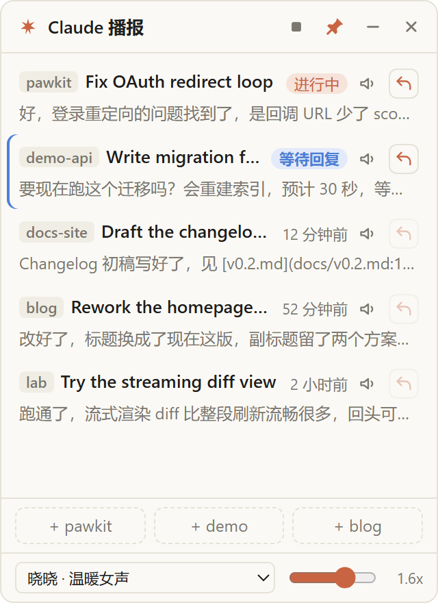

# claude-float · Claude 播报

[English](README.md) · [简体中文](README.zh-CN.md)

  

Windows 上一个置顶的小浮窗，给 **Claude Code / Codex**（命令行）用：会话状态一览、朗读最新回复、不用切窗口直接回复。

<p align="center"></p>

## 解决什么问题

Claude Code 跑在终端里，看一眼它说完没有、回一句话，都得切窗口。这个浮窗钉在角落，把你最高频的三件事留在手边：

1. **瞄一眼** —— Claude 在干活、在等我拍板、还是说完了？
2. **听一下** —— 朗读最新回复，手不用离开编辑器
3. **回一句** —— 直接把一句话塞进会话，不碰窗口

## 功能

- **Claude / Codex 一键切换** —— 标题栏的开关一键换形态：会话列表、主题色、快捷启动命令、回复通道整套跟着切
- **会话列表**：读 `~/.claude/projects/*/*.jsonl`（只读），列出最近会话
- **状态标注**：每个会话显示 **进行中**（Claude 在干活）/ **等待回复**（Claude 在问你、等你确认计划，多半在等你批准）/ 最后一条回复是多久之前。状态优先用 Claude Code 自己写的 `~/.claude/sessions/<pid>.json`，会话没在跑时才从会话记录推测
- **订阅用量**（可选）：底部一行显示 GLM Coding Plan 各重置窗口的已用百分比（`5-hour 64% · weekly 38%`），悬停看剩余额度和重置时间，点击打开控制台。在 `~/.claude-float/glm.json` 里配置 API key 才显示，没有就不显示
- **点会话那一行**：
  - 会话还在跑 → 把它的终端窗口在前台/后台间切换（已在前台再点一下就最小化）
  - 会话已结束 → 新开一个 PowerShell 终端，回到会话原目录用 `claude --resume` 恢复
- **朗读**（喇叭按钮）：朗读这个会话的最新回复；再点一次、点标题栏的方块或按 `Esc` 停止。朗读前会清理 Markdown：代码块读成「代码略」，链接只读文字，路径只读文件名，表格按行读
- **快速回复**（橙色箭头，仅限 `cf` 启动的会话）：在浮窗里打字，`Enter` 发送 / `Shift+Enter` 换行 / `Esc` 取消。消息通过 Claude Code 官方的 [Channels](https://code.claude.com/docs/en/channels)（研究预览）直接推进会话——不切窗口、不往终端里模拟按键。Claude 空闲会马上回复，正忙会排到下一轮
- **快捷启动**：点底部按钮弹菜单——在常用目录起一个普通会话、给这个目录新建代办、或挑一张未完成的代办起会话并挂单（新 PowerShell 终端，claude 退出后窗口留在提示符方便回看）
- **代办单**（标题栏剪贴板图标，带未完成数角标）：按工作区（=快捷启动目录）管事的轻量看板。新建填标题、描述（可选）、工作区；可按工作区筛选，默认看未完成，可切已完成。从代办起会话（或在启动菜单里点单）会**自动挂单**：浮窗认出该目录冒头的新会话，把会话 id 记进 `~/.claude-float/todos.json`。挂上的会话行带「单·」标签，点标签跳回那张单；单上透传所挂会话的 进行中/等待回复 状态。也可以在单子的展开区手动绑定/解绑会话
- **桌面宠物**：屏幕角落蹲一只小宠物，跟会话状态换表情——有会话在跑就原地跑步、等你拍板就歪头、刚干完活跳一下庆祝；等你回复时头上挂个数徽章。**宠物上方常驻一块会话托盘**（显示 进行中/等你/刚完成 的会话，没有就只剩宠物）：Claude + Codex 两边一屏看全，等你拍板的排最前，每条带彩色状态点，点一条直接切到那个终端；点开 等你/刚完成 的会话它就从托盘消失，完成的会话会以「空闲」留在托盘里等候查看；点宠物本体切换浮窗显隐，双击隐藏（托盘里再开）。直接识别 CodeX 的宠物包（`~/.codex/pets/`），自己的宠物放 `~/.claude-float/pets/`，托盘菜单里可开关和挑选
- **窗口**：图钉置顶 · 横线收起成一条 · 叉隐藏到托盘；位置、大小、置顶状态会记住。托盘图标（橙色圆点）单击显示/隐藏，右键菜单可开关「开机自动运行」（默认关）和退出
- **语音**：默认在线神经语音（和 Edge「大声朗读」同一套，晓晓 / 云希等，接近真人），连不上自动降级系统离线语音

### Codex 形态

同一个浮窗，指向 Codex CLI 的会话记录（`~/.codex/sessions/**/rollout-*.jsonl`，只读，支持 `CODEX_HOME`）：

- **会话列表 + 状态**：Codex 没有活会话登记表，状态（进行中 / 等你批准 / 空闲）从记录尾部推断，思路和 Claude 的降级路径一致
- **标题**：优先用桌面端写的官方线程名（`~/.codex/session_index.jsonl`），纯 CLI 会话退回首句提问
- **点会话那一行**：还在跑 → 切换它的终端前台/后台；已结束 → 在原目录新开 PowerShell 跑 `codex resume <id>`
- **快速回复**：Codex 没有 channels 等价物；会话还开在终端里时，直接用 `WriteConsoleInputW` 往它的控制台打字（不抢焦点、不碰剪贴板）。会话和进程靠「rollout 里的会话创建时间 ≈ codex 进程启动时间」匹配（进程须先于会话启动、提前量 ≤15 分钟——新目录第一次启动要等信任确认，会慢几分钟）；从 Codex 桌面端起的会话没有控制台，没法直接回，点行恢复即可
- **快捷启动**：底部按钮在常用目录起 `codex`

## 快速开始

**前提**：Windows 10/11，Node.js 20+，[Claude Code CLI](https://docs.claude.com/en/docs/claude-code/overview) 已装好且终端里能用；要用 Codex 形态再装 [Codex CLI](https://developers.openai.com/codex/)（可选）。

```bash
git clone https://github.com/kizenY/claude-float.git
cd claude-float
npm install
claude mcp add -s user claude-float -- node <仓库路径>/channel/server.js   # 快速回复要用
npm start
```

日常使用双击 `start.vbs`（不弹命令行窗口）。想开机自动打开：托盘菜单勾选「开机自动运行」（写入 `HKCU\...\CurrentVersion\Run`，取消勾选就删掉）。想让 Win 键搜索找到应用：`powershell -File scripts\start-menu.ps1`（在开始菜单放一个 `claude-float` 快捷方式，`-Remove` 撤销）。

> `claude mcp add` 那行把频道 server 注册到 user scope，所有 claude 会话都会加载它；但只有用 `cf` 启动的会话真正开了频道，浮窗也只给这种会话显示回复按钮。想撤销注册：`claude mcp remove claude-float`。

### `cf` 启动器

仓库里的 `cf.cmd` 会带着频道启动 Claude Code：

```
cf [任何 claude 参数]
```

首次启动会弹一个开发频道的警告，选「I am using this for local development」继续。不是用 `cf` 启动的会话，回复按钮是半透明的；已经跑起来的会话没法补频道，下次用 `cf` 启动即可。

`cf` 还支持一个可选的分流网关（配置见上文的「分流网关」节）——没有网关配置文件时它就是一条普通的 `claude` 启动命令。

## 配置

### 快捷启动目录

`~/.claude-float/quick-dirs.json`：

```json
[
  { "name": "项目A", "path": "D:\\work\\proj-a" },
  { "name": "lab", "path": "D:\\lab" }
]
```

没有这个文件就只显示一个 home 按钮。改完配置重启浮窗生效。这些目录同时就是代办单的「工作区」。

### 桌面宠物

宠物窗口读两类目录，同名时自有目录优先：

| 目录 | 说明 |
|---|---|
| `~/.claude-float/pets/<id>/` | 自己的宠物 |
| `~/.codex/pets/<id>/` | [Codex CLI](https://developers.openai.com/codex/) 的宠物，自动导入，不用动 |

每个宠物一个目录，`pet.json` + 一张精灵图（PNG / WebP），格式和 CodeX 对齐：

```json
{
  "displayName": "平安",
  "description": "一只毛绒小狗",
  "spritesheetPath": "spritesheet.png",
  "frame": { "width": 192, "height": 208, "columns": 8, "rows": 9 },
  "animations": { "wave": { "frames": [24, 25, 26, 27], "fps": 7, "loop": false } }
}
```

- 精灵图按网格切帧：一帧 `width x height` 像素，`columns x rows` 个格子铺满整张图。`frame` 可以整个省略，默认按 192x208 一帧、8 列从图片尺寸反推行数
- 帧序号从左到右、从上到下数。内置动画行号：0 待机 · 1 向右跑 · 2 向左跑 · 3 挥手 · 4 跳 · 5 失落 · 6 等待 · 7 原地跑 · 8 巡视；`animations` 可选，用来覆盖或新增（省略 `fps` 时 8，`loop: false` 表示播一遍回落待机）
- 会话托盘常驻在宠物上方：等你的排最前，每条带彩色状态点；刚完成的会话以「空闲 · N 分钟前」留在托盘等候查看，在跑的永远显示；点开 等你/空闲 的会话即算已处理，从托盘消失（等它下次再有动静会自动回来）；等回复的会话还会在宠物头顶挂数字徽章。位置、开关、选中的宠物都记在托盘菜单里；宠物窗口拖哪算哪，单击切换浮窗显隐，双击隐藏

### 分流网关（可选）

浮窗可以配合「按复杂度把请求路由到高档/低档模型」的本地分流网关使用。所有网关配置都放本机，仓库不含任何个人路径：

`~/.claude-float/gateway.conf`（两行，ASCII）：

```
health=http://127.0.0.1:8787/health
settings=C:\path\to\gateway-settings.json
```

- 有这个文件时，`cf` 启动前先探测 `health`，活着就把 `settings` 指定的配置文件（建议用 `ANTHROPIC_AUTH_TOKEN`，用 `ANTHROPIC_API_KEY` 会每次弹「custom API key」确认）经 `--settings` 挂给新会话——即「新会话走网关」
- 没有这个文件 = 纯直连，`cf` 里零网关逻辑
- 托盘菜单的 **「新会话走 jev 网关」** 开关（配了 gateway.conf 才出现）控制这个行为：落地为创建/删除 `~/.claude-float/gateway-off` 文件，只影响新起的会话，已在跑的不变

### 订阅用量（GLM Coding Plan）

`~/.claude-float/glm.json`：

```json
{ "apiKey": "你的 Coding Plan API key" }
```

浮窗底部显示一行 `5-hour 64% · 18:24 重置 · weekly 38% · 10/21 重置`（各重置窗口的已用百分比和重置时间，主进程每分钟拉一次 [官方用量接口](https://docs.bigmodel.cn/cn/coding-plan/overview)）。Z.ai 用户加 `"endpoint": "https://api.z.ai"`。没有这个文件就不显示这一行，其他功能不受影响。

### 环境变量

| 变量 | 作用 |
|---|---|
| `CLAUDE_FLOAT_PROJECTS` | 逗号分隔的关键字，只显示项目目录名包含这些关键字的会话，如 `pawkit,lab` |
| `CLAUDE_FLOAT_CODEX_EXCLUDE` | Codex 形态：逗号分隔的关键字，工作目录命中即隐藏。默认 `e:\agent-cluster`（同一台机器上其他 Agent 共用 `~/.codex/sessions`，不串台） |
| `CLAUDE_FLOAT_SPAWN_CMD` | 调试：快捷启动改拉这个命令，排查 spawn 问题时用 |
| `CLAUDE_FLOAT_SNAPSHOT` | 调试：启动后截图到该路径 |
| `CLAUDE_FLOAT_QUIT_AFTER_SNAPSHOT` | 调试：截图完自动退出（脚本化 smoke 用） |

### 语音

底部可选声音和语速。在线语音走微软的语音服务（`speech.platform.bing.com`），和 Edge「大声朗读」同一套非官方接口，微软改了可能失效。连不上时自动用系统语音读完剩下的，标题栏会提示；优先直连，失败再走 `HTTPS_PROXY`。

## 快速回复的原理

`channel/server.js` 是个 MCP server，由 Claude Code 随会话拉起。它在 `127.0.0.1` 随机端口上等消息，把会话登记到 `~/.claude-float/channels/<pid>.json`（含每会话一个的一次性密令）。浮窗读这些登记文件，通过 `notifications/claude/channel` MCP 通知把你的文字推进会话。全程只在 localhost，密令每个会话独立、一次性。

频道通知送不到时（某些 Claude Code 版本会静默吞掉，见 [issue #44181](https://github.com/anthropics/claude-code/issues/44181)），浮窗自动降级：先用 `WriteConsoleInputW` 往会话的真实控制台注入按键（不抢前台、不碰剪贴板），还不行才聚焦 + 粘贴 + 回车。

## 常见问题

| 现象 | 处理 |
|---|---|
| 回复按钮是半透明的 | 会话不是用 `cf` 启动的。退出后用 `cf` 重新启动 |
| `cf` 启动时弹开发频道警告 | 每个会话一次，正常现象；选「I am using this for local development」 |
| 回复发出去 Claude 没反应 | 对一下 Claude Code 版本是否中了 [issue #44181](https://github.com/anthropics/claude-code/issues/44181)；浮窗会降级到控制台注入，前提是那个会话的终端窗口还在 |
| 列表里没有会话 | 浮窗读 `~/.claude/projects/*/*.jsonl`——确认至少跑过一次 `claude`，再检查 `CLAUDE_FLOAT_PROJECTS` 是不是把会话全过滤掉了 |
| Codex 回复按钮是半透明的 | 这个 Codex 会话已经不在终端里跑了（或是桌面端起的）。点列表行 `codex resume` 恢复后再回 |
| Codex 列表里没有会话 | 确认至少跑过一次 `codex`；再检查 `CLAUDE_FLOAT_CODEX_EXCLUDE` / `CLAUDE_FLOAT_PROJECTS` 是不是把会话过滤掉了 |
| 新目录起 codex 后列表里一直「没在终端里跑」 | 第一次进新目录 codex 会弹「信任确认」，会话要等你确认后才创建；在终端里确认一次，这个目录以后就正常了 |
| 在线语音突然不响 | 非官方接口失效或被墙；浮窗会自动降级系统语音。走了代理的检查 `HTTPS_PROXY` |
| 浮窗不见了 | 找橙色托盘图标，单击切换显示/隐藏 |

## 开发

```bash
npm test        # 纯 Node 测试，不需要起 Electron
npm start       # 起浮窗
```

```
main.js             Electron 主进程：窗口、托盘、IPC
renderer.js         浮窗 UI 与朗读调度
pet.js / pet.html / pet-renderer.js   桌面宠物：宠物包解析 + 宠物窗口
sessions.js         读 ~/.claude/projects 会话记录 + 状态推测
codex-sessions.js   读 ~/.codex/sessions 会话记录 + 状态推测 + 活进程匹配
channel/server.js   Claude Code 频道 server（快速回复的入口）
cf.cmd / spawn-cf.vbs / start.vbs   启动脚本（Windows 控制台句柄的几个坑都写在代码注释里）
```

## License

[MIT](LICENSE)
